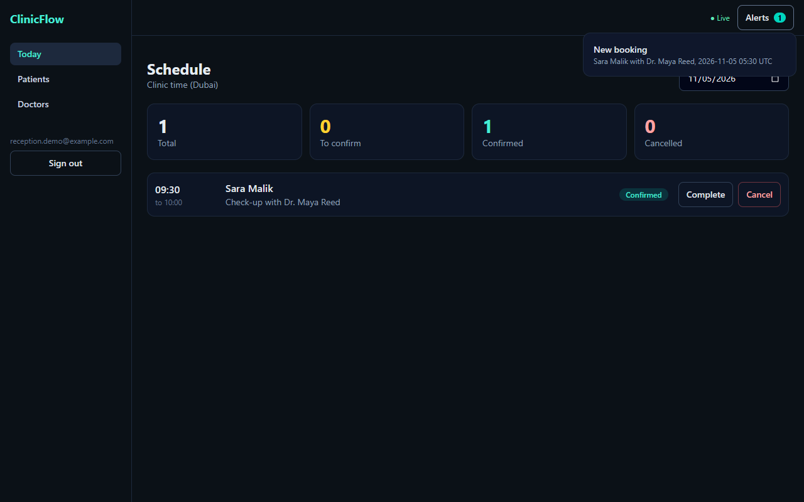
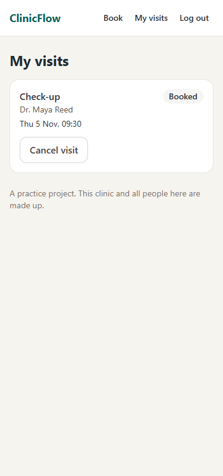
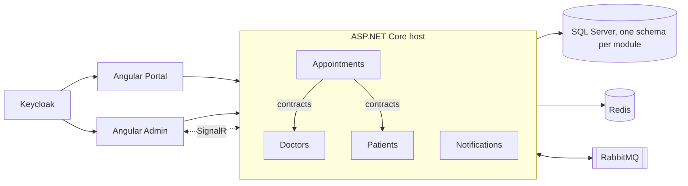

# ClinicFlow

A clinic booking system built as a **modular monolith** with .NET 10 and Angular.

Patients book visits in a portal. Reception runs the day in an admin app and sees new bookings live.

> This is a personal practice project. The clinic, doctors and patients are made up. It is not client work.

| Reception (Admin app) | Patient (Portal app) |
|---|---|
|  |  |

## What it shows

| Topic | Where to look |
|---|---|
| Modular monolith, one SQL schema and one DbContext per module | [`backend/src/Modules`](backend/src/Modules) |
| Module boundaries checked by tests | [`ModuleBoundaryTests.cs`](backend/tests/ClinicFlow.ArchitectureTests/ModuleBoundaryTests.cs) |
| CQRS with a small custom dispatcher and pipeline | [`Dispatcher.cs`](backend/src/BuildingBlocks/ClinicFlow.BuildingBlocks/Cqrs/Dispatcher.cs) |
| Domain model with rules and domain events | [`Appointment.cs`](backend/src/Modules/Appointments/ClinicFlow.Modules.Appointments/Domain/Appointment.cs) |
| Transactional outbox | [`ModuleDbContext.cs`](backend/src/BuildingBlocks/ClinicFlow.BuildingBlocks/Persistence/ModuleDbContext.cs), [`Outbox.cs`](backend/src/BuildingBlocks/ClinicFlow.BuildingBlocks/Persistence/Outbox.cs) |
| RabbitMQ with a dead letter queue | [`RabbitMq.cs`](backend/src/BuildingBlocks/ClinicFlow.BuildingBlocks/Messaging/RabbitMq.cs) |
| Real-time updates with SignalR | [`NotificationsModule.cs`](backend/src/Modules/Notifications/ClinicFlow.Modules.Notifications/NotificationsModule.cs) |
| Redis caching | [`DoctorFeatures.cs`](backend/src/Modules/Doctors/ClinicFlow.Modules.Doctors/Features/DoctorFeatures.cs) |
| Keycloak login (OpenID Connect, PKCE, roles) | [`Auth.cs`](backend/src/Host/ClinicFlow.Api/Auth.cs), [`auth.service.ts`](frontend/projects/shared/auth.service.ts) |
| NgRx store and effects | [`schedule/`](frontend/projects/admin/src/app/schedule) |
| Angular signals and RxJS | [`book.page.ts`](frontend/projects/portal/src/app/book.page.ts) |

## Architecture



| Module | Job |
|---|---|
| **Doctors** | Doctors, working hours, treatments and prices |
| **Patients** | Patient profiles and search |
| **Appointments** | Free slots, booking, confirm, complete, cancel |
| **Notifications** | Turns events into staff alerts and pushes them live |

Modules talk in two ways only:

1. **Sync reads** go through a small interface in a `Contracts` project, such as `IDoctorsModule`.
2. **Events** go through the outbox and RabbitMQ, such as `AppointmentBooked`.

A module never references another module's code. A test fails if it does.

## Three design decisions

**No double booking, even in a race.** Each appointment owns one `SlotBlock` row per 15 minutes, with a unique index on `(DoctorId, StartsAtUtc)`. If two requests race, the database accepts one and the other gets a `409`. This also catches overlaps that start at different times. It needs no locks and works on any SQL database.

**Events cannot get lost.** Domain events are saved as outbox rows in the same transaction as the change. A background worker publishes them. Delivery is at-least-once, so consumers are idempotent: a notification has a unique `SourceEventId`.

**One event can start a chain.** When an admin deactivates a doctor, `DoctorDeactivated` makes Appointments cancel upcoming visits. Each cancel raises `AppointmentCancelled`, and Notifications alerts reception. The Doctors module knows nothing about this.

## Run it

You need the .NET 10 SDK and Node 24.

### Quick way (no Docker)

Uses SQL Server LocalDB, an in-memory event bus and a local sign-in screen.

```bash
cd backend
dotnet run --project src/Host/ClinicFlow.Api

cd frontend
npm install
npm run admin    # http://localhost:4200
npm run portal   # http://localhost:4201
```

### Full stack (Docker)

Uses SQL Server, RabbitMQ, Redis and Keycloak.

```bash
cp .env.example .env    # then set your own values
docker compose --profile full up -d --build

cd frontend
npx ng serve admin --configuration docker
npx ng serve portal --configuration docker
```

Sample logins, password `demo`: `admin.demo`, `reception.demo`, `sara`. They exist only in the local Keycloak.

## Tests

```bash
cd backend
dotnet test                       # unit, architecture and integration tests
node scripts/smoke-test.mjs       # live check against the Docker stack
```

The integration tests run the real HTTP pipeline, including a race where many patients try to book one time. The smoke test repeats the race on SQL Server, and follows an event through the outbox and RabbitMQ.

## Not built yet

- Frontend unit tests
- Real email or SMS sending
- Outbox locking for running more than one API instance
- Treatment management in the Admin app (the API has it)
- Weekly working hours editor in the Admin app (the API has it)

## License

MIT
